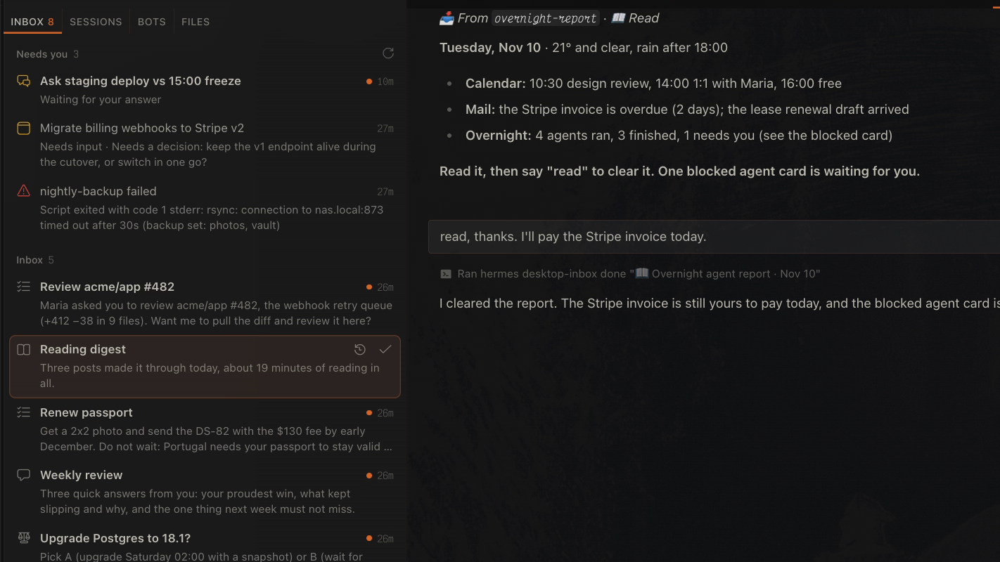

# Inbox for Hermes Desktop

**One place for your entire swarm.**

**[▶ Watch the 60-second demo](docs/demo.mp4)**

Your Hermes agents work while you sleep: cron jobs, webhooks, kanban workers, subagents. Their
output lands in many places. A bot chat you never scroll, a card stuck in triage, a job that
failed without a sound. Inbox gives all of it one place to land, and gives every item one clear
ask, so that you can close it.

> Every thread you open, you close.



## Why it is different

- **Built for work your agents start.** Most inboxes sort the threads that you start. This one
  collects what your agents start for you: cron results, webhook events, blocked cards, failed
  jobs. You do not go looking for the work. The work comes to you.
- **Every item is a real conversation.** An item is not a notification or a row in a list. It is
  a Desktop conversation that Hermes starts, with the content and one ask: **Read**, **Answer**,
  **Decide** or **Do**. Reply in it, tell Hermes to do the task, or give the job feedback. Hermes
  already knows what the item is and how to handle your reply.
- **"Needs you" covers the whole swarm.** Chats that wait on your answer (a pending clarify or
  approval), kanban cards that are blocked or in triage, and cron jobs that failed sit at the top
  of the pane. Click a failed job and Hermes files a Fix item and starts the diagnosis.
- **Triage it like email.** `j`/`k` move, `Enter` opens, `e` closes, `s` snoozes, `z` undoes.
  Every action is instant and has a 5-second Undo.
- **It closes itself.** An item that started a kanban card closes when the card is done. A
  snoozed item comes back at its time with a notification.
- **Yours to shape.** Add item types (a `pay` type with its own icon and rule, for example), set
  your name, a reply style and the empty-pane text. Every setting is in the Desktop settings form.
- **No lock-in, no extra database.** Items are normal Hermes sessions. Done means archived. Remove
  the plugin and every conversation is still in Hermes.
- **Plays by the rules.** Public Hermes APIs only. `hermes plugins validate` passes with zero
  warnings. No telemetry, no stored credentials, and no network calls except one optional
  `gh api user` for the webhook.

## What it does

- **One conversation per item.** A daily digest does not pile into one long bot chat. Every run
  is its own thread with its own ask.
- **A triage queue.** Sections: Needs you, Inbox, Snoozed, Done. Every row shows the ask line,
  so you know what an item needs before you open it.
- **Snooze.** Later today, this evening, tomorrow morning, next week, or any time from the CLI.
- **Notifications.** An in-app toast when Hermes has focus, an OS notification when it does not.
- **Optional webhook.** GitHub review requests and any `POST` can file items.
- **A CLI for scripts and cron jobs.** `hermes desktop-inbox new` files an item from anywhere.
- **A bundled skill.** Ask Hermes to "wire my morning-brief job to the Inbox", and it does.

## Install

```bash
hermes plugins install desktop-inbox            # from the catalog, once listed
# or, straight from GitHub:
hermes plugins install Nj07r/hermes-desktop-inbox
hermes plugins enable desktop-inbox
```

Restart the gateway (`hermes gateway restart`) and reload the Desktop window. The Inbox opens
from the inbox icon in the status bar.

Requirements: Hermes 0.23.1 or later, and Hermes Desktop for the pane. The CLI works without
Desktop.

## Send your first item

```bash
echo "The plugin works. Say done to close this item." | \
  hermes desktop-inbox new --type read --title "Hello Inbox" --source manual
```

The command takes 10 to 30 seconds, because Hermes writes the one-line ask. The output is JSON
with the item id and title. The item appears in the pane as "Hello Inbox". Open it and say
"done". Hermes closes it.

## How to send a cron job's result to the Inbox

The plugin ships a skill for this. Ask Hermes:

> Load the skill desktop-inbox:inbox and wire my "morning-brief" cron job to the Inbox.

Hermes sets the job delivery to `local` and adds an inbox step to the end of the job prompt.
If you prefer to edit the job yourself, add this block to the end of its prompt:

```text
INBOX STEP (last step):
- If nothing in this run needs the user, file nothing and end with "Nothing for the inbox."
- Otherwise write the message for the user to /tmp/morning-brief.md and run:
  hermes desktop-inbox new --type read --title "Morning brief" --source morning-brief --body-file /tmp/morning-brief.md
- If that command fails, end your answer with "INBOX FAILED: <the error>" and stop. Do not retry.
```

Use `--reply-notes` to tell the Hermes in the item how to handle your replies. For example, a
news digest can say: "When the user says 'more like this', add the topic to ~/notes/taste.md."

Some ideas:

| Job | Type | Ask |
|---|---|---|
| Morning brief (calendar, mail, weather) | Read | Read it, then say read. |
| Weekly review | Answer | Answer three questions about the week. |
| Dependency or price watch | Decide | Upgrade now or wait? |
| Bill or renewal reminder | Do | Pay it, then say done. |
| PR review request (webhook) | Do | Review the PR with Hermes. |

## How to add your own item type

Item types are the built-in `read`, `answer`, `decide` and `do`, plus the ones in the `types`
setting. A type has an `emoji` (in the title), a `label`, an `icon` (a
[codicon](https://microsoft.github.io/vscode-codicons/dist/codicon.html) name in the pane) and
`how` (the rule for Hermes; `{user}` becomes your name). All fields are optional.

```yaml
# ~/.hermes/config.yaml
plugins:
  entries:
    desktop-inbox:
      settings:
        types:
          pay:
            emoji: "💳"
            label: Pay
            icon: credit-card
            how: "{user} pays it, then says 'paid'."
          read:
            icon: eye        # change one field of a built-in type
```

Run `hermes desktop-inbox types` to see the result. The emoji at the start of a title tells the
pane the type, so give each type its own emoji.

## How to make it yours

All settings are in Desktop under **Settings → Plugins → desktop-inbox**, or in `config.yaml`
under `plugins.entries.desktop-inbox.settings`. A personal setup can look like this:

```yaml
plugins:
  entries:
    desktop-inbox:
      settings:
        user_name: Ada
        reply_style: "short and warm, no jargon"
        empty_title: Inbox zero
        empty_message: The well is still.
        watched_jobs: [morning-brief, weekly-review]
        webhook_enabled: true
        github_login: ada
```

## Settings

| Key | Type | Default | Meaning |
|---|---|---|---|
| `user_name` | str | `""` | How item conversations refer to you. Empty means "the user". |
| `reply_style` | str | `""` | One extra style rule for Hermes in every item. |
| `types` | dict | `{}` | New item types, or changes to the built-in ones. |
| `watched_jobs` | list | `[]` | Cron jobs whose failures show under "Needs you". Empty means every enabled job. |
| `empty_title` | str | `Inbox zero` | Title of the empty pane. |
| `empty_message` | str | `Nothing needs you.` | Line under the empty-pane title. |
| `done_days` | int | `7` | Days that closed items stay in "Done". |
| `morning_hour` | int | `9` | Hour for "tomorrow", "next week" and weekday snoozes. |
| `evening_hour` | int | `20` | Hour for the "evening" snooze. |
| `settle_after_minutes` | int | `15` | Minutes after its card is done before an item closes itself. |
| `inbox_dir` | str | `""` | Folder that groups the items as a Desktop project. Empty means `HERMES_HOME/inbox`. |
| `webhook_enabled` | bool | `false` | Start the webhook listener on 127.0.0.1. |
| `webhook_port` | int | `8788` | Port of the webhook listener. |
| `github_login` | str | `""` | Whose review requests become items. Empty asks `gh api user` once. |
| `github_review_notes` | str | `""` | Reply notes for review-request items. Empty uses the built-in notes. |
| `webhook_token` | secret | | `DESKTOP_INBOX_WEBHOOK_TOKEN`. If set, `POST /item` needs `Authorization: Bearer <token>`. |
| `github_webhook_secret` | secret | | `DESKTOP_INBOX_GITHUB_SECRET`. If set, `POST /github` checks `X-Hub-Signature-256`. |

## CLI

| Command | Does |
|---|---|
| `hermes desktop-inbox new --type T --title NAME [--source S] [--reply-notes TEXT \| --reply-notes-file F] [--body TEXT \| --body-file F]` | Files an item. The body comes from stdin when no body flag is given. |
| `hermes desktop-inbox list [--all] [--json]` | Lists open (and with `--all`, recently done) items and failing jobs. |
| `hermes desktop-inbox done [REF]` | Closes an item. `REF` is a session id or exact title; inside an item, no `REF` is needed. |
| `hermes desktop-inbox reopen REF` | Puts a closed item back. |
| `hermes desktop-inbox snooze [REF] [WHEN]` | Parks an item. `WHEN`: `30m`, `2h`, `1d`, `1w`, `tomorrow`, `evening`, `next-week`, a weekday, or an ISO date-time. Default `tomorrow`. |
| `hermes desktop-inbox wake REF` | Brings a snoozed item back now. |
| `hermes desktop-inbox settle-done` | Closes items whose kanban card is done. The pane does this on every poll. |
| `hermes desktop-inbox types` | Shows the item types. |
| `hermes desktop-inbox webhook [--test]` | Runs the webhook listener in the foreground, or posts a test item to it. |

`bin/inbox-item` is a short alias. Link it into your `PATH` if you want it.

## Webhook

Off by default. With `webhook_enabled: true` the pane backend starts a listener on
`127.0.0.1:<webhook_port>`:

| Route | Does |
|---|---|
| `POST /item?type=do&title=Name&source=webhook` | Files the request body as an item. Identical posts within 24 hours are dropped. |
| `POST /github` | Files a Do item when a pull request asks `github_login` for a review. Other events are logged and ignored. |
| `GET /health` | Returns `{"ok": true}`. |

```bash
curl -d 'The backup finished with 2 warnings.' 'localhost:8788/item?type=read&title=Backup&source=nas'
```

The listener binds to localhost only. To receive GitHub events, put it behind a tunnel (for
example `tailscale funnel 8788` or an smee.io forwarder) and set `github_webhook_secret`. Raw
payloads are kept in `<inbox folder>/webhook-log/`.

## What the plugin reads, writes and runs

- **Reads** `state.db` (read-only SQL) for the item conversations, `cron/jobs.json` and
  `cron/output/` for job health, and every `kanban.db` (read-only) for blocked cards.
- **Writes** session changes only through Hermes's public `SessionDB` methods: title, folder,
  archive state, the hidden flag on an item's opening message and its first Hermes message. It
  writes its own files (`snooze.json`, `.settled.json`, `.seeds/`, `webhook-log/`) in the inbox
  folder.
- **Runs** `hermes chat` once per new item (one model turn, to write the ask line),
  `hermes kanban archive` when you archive a card from the pane, and `gh api user` once when the
  webhook needs your GitHub login and `github_login` is empty.
- **Network**: none of its own. With the webhook on, it listens on 127.0.0.1 only.
- No telemetry, no stored credentials (secrets come from Hermes's secret store).

## About the design

An item is a real Desktop conversation, not a row in a separate list, because the useful part
of an inbox item is what happens after you open it. You ask a follow-up, you tell Hermes to do
the task, you give feedback to the job. A real conversation keeps all of that, and Hermes
already knows the context from the hidden opening message.

`hermes chat` stores that opening message as a user message, so the plugin marks it hidden and
replaces Hermes's first reply with a readable one: the content, then the ask in bold. The model
still sees both.

Done means archived. A snooze is an archive plus a wake time. There is no extra database to
keep in sync with Hermes.

## Develop

```bash
git clone https://github.com/Nj07r/hermes-desktop-inbox
ln -s "$PWD/hermes-desktop-inbox" ~/.hermes/plugins/desktop-inbox
hermes plugins enable desktop-inbox
hermes plugins validate ./hermes-desktop-inbox
python -m unittest discover -s hermes-desktop-inbox/tests   # use the Python that runs Hermes
```

Desktop copies `desktop/plugin.js` when the window reloads. Backend changes to
`desktop_inbox/` apply on the next pane poll. Changes to `dashboard/plugin_api.py` need a
gateway restart.

## Credits

The inbox model (settle, snooze, auto-settle, "every thread you open, you close") is inspired by
the inbox-style sidebar in [T3 Code](https://github.com/pingdotgg/t3code). This plugin brings the
same idea to the work that your agents start.

## License

MIT
