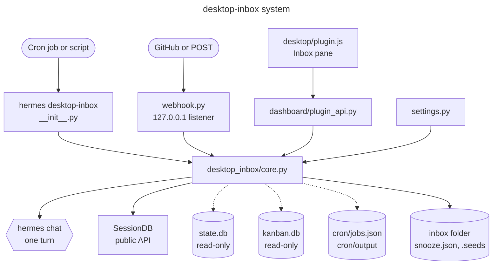
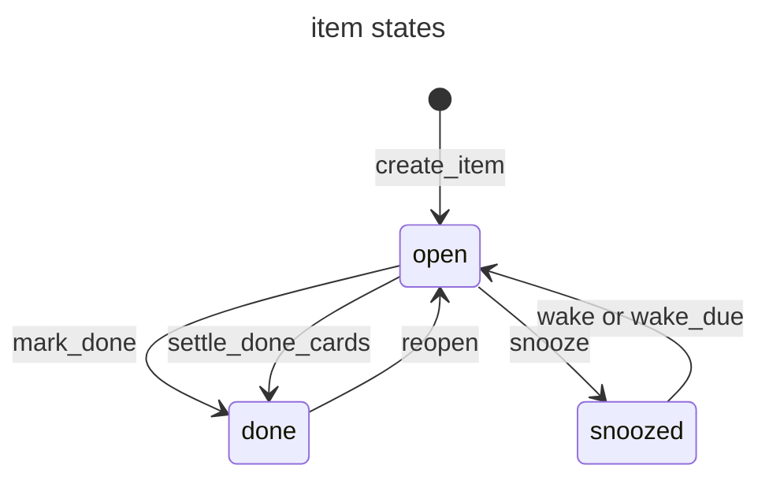

# About the desktop-inbox architecture

The plugin has three ways in and one core. A cron job or a script runs `hermes desktop-inbox new`. The Desktop pane polls its backend every 60 seconds. The optional webhook listener receives `POST` requests on `127.0.0.1`. All three call functions in [`desktop_inbox/core.py`](../../desktop_inbox/core.py), and the core is the only module that touches Hermes data.

Data enters as an item body. The core writes a seed file, starts one `hermes chat` turn and then changes the new session through `SessionDB`. Data leaves through the pane, which reads the session list, and through the item conversation in Desktop. State lives in Hermes itself: `state.db` for sessions, `cron/jobs.json` for job health and `kanban.db` files for cards. The plugin adds only small JSON files in the inbox folder.

## System diagram

Dotted edges are read-only access. The two hot nodes are the path that every new item takes.

## Components

- **Plugin entry**: parses the CLI and registers the skill. See [modules/plugin-entry.md](modules/plugin-entry.md).
- **Core**: owns the item model and every read and write. See [modules/core.md](modules/core.md).
- **Settings**: merges defaults from `plugin.yaml` with user values and reads secrets. See [modules/settings.md](modules/settings.md).
- **Webhook**: turns HTTP requests into items. See [modules/webhook.md](modules/webhook.md).
- **Pane backend**: a thin FastAPI router over the core. See [modules/dashboard.md](modules/dashboard.md).
- **Pane**: the React UI, the chip and notifications. See [modules/desktop.md](modules/desktop.md).

## Why an item is a real session

The useful part of an inbox item is what happens after the user opens it. The user asks a follow-up, tells Hermes to do the task, or gives feedback to the job. A row in a separate list cannot hold that work. A Hermes session can, and the item's Hermes already has the context from the seed.

The cost is that `hermes chat` stores the seed as a user message. Desktop would paint it as the user's own bubble with raw markdown. `present()` in the core fixes this after the fact. It marks the seed row `hidden`, appends a readable assistant message and deactivates the original one-line reply. The model still sees both messages. This step is best effort: if it fails, the item still works and only looks plainer.

## Why there is no item database

Item state comes from two facts that Hermes already stores, plus one small file:

- **open**: the session is in the inbox folder and not archived. A row that the `sessions.auto_archive` idle sweep hid still counts as open.
- **done**: `archived = 1` and `auto_archived = 0`, so the user archived it on purpose.
- **snoozed**: archived on purpose and listed in `snooze.json` with a wake time.

With this model, nothing can drift out of sync with Hermes. If the user removes the plugin, every item is still a normal conversation. The trade-off is that the core must query `state.db` directly, with SQL that depends on Hermes column names such as `auto_archived` and `display_kind`. A Hermes schema change can break the listing. The core opens every connection with `mode=ro`, so a break cannot damage data.

There is no scheduler for snoozes. `list_items()` calls `wake_due()` first, so the pane poll or any `list` command wakes items whose time has passed. The same pattern applies to auto-settle: the pane backend calls `settle_done_cards()` on every `/items` request. Without a poll, nothing wakes or settles.

## Why writes go through SessionDB

Reads use raw SQL because they need joins and filters that `SessionDB` does not offer. Writes use only public `SessionDB` methods: `set_session_archived`, `update_session_cwd`, `set_session_title`, `set_latest_matching_message_display_kind`, `append_message` and `deactivate_message`. This keeps the plugin inside the public Hermes surface, and `hermes plugins validate` checks that the plugin does not rebind core code.

## Safety decisions

Items can carry text from outside the machine, for example a webhook payload. Several rules in the code follow from that:

- `_clean_env()` removes `HERMES_YOLO`, `HERMES_ACP_AUTO_APPROVE` and every `HERMES_CRON*`, `HERMES_SESSION*` and `HERMES_KANBAN*` variable before it starts `hermes chat`. A parent's auto-approve mode never reaches an item.
- `check_name()` limits titles to letters, digits, spaces and a short list of punctuation, 120 characters at most. Titles go into prompts and show in commands, so shell characters are refused.
- The webhook binds to `127.0.0.1` only, refuses requests with an `Origin` header and does not start without a token or a GitHub secret.
- `archive_card()` checks board and card ids against `[A-Za-z0-9._-]+` before it passes them to `hermes kanban`.

## Hot reload

The pane backend calls `importlib.reload()` on `settings` and `core` at every `/items` request. Edits to those two files apply on the next poll without a gateway restart. `reload()` changes the module objects in place, so the running webhook thread also uses the new core code. The `webhook` module itself is not reloaded, and edits to `plugin_api.py` need a gateway restart. The README "Develop" section gives the same rule.
