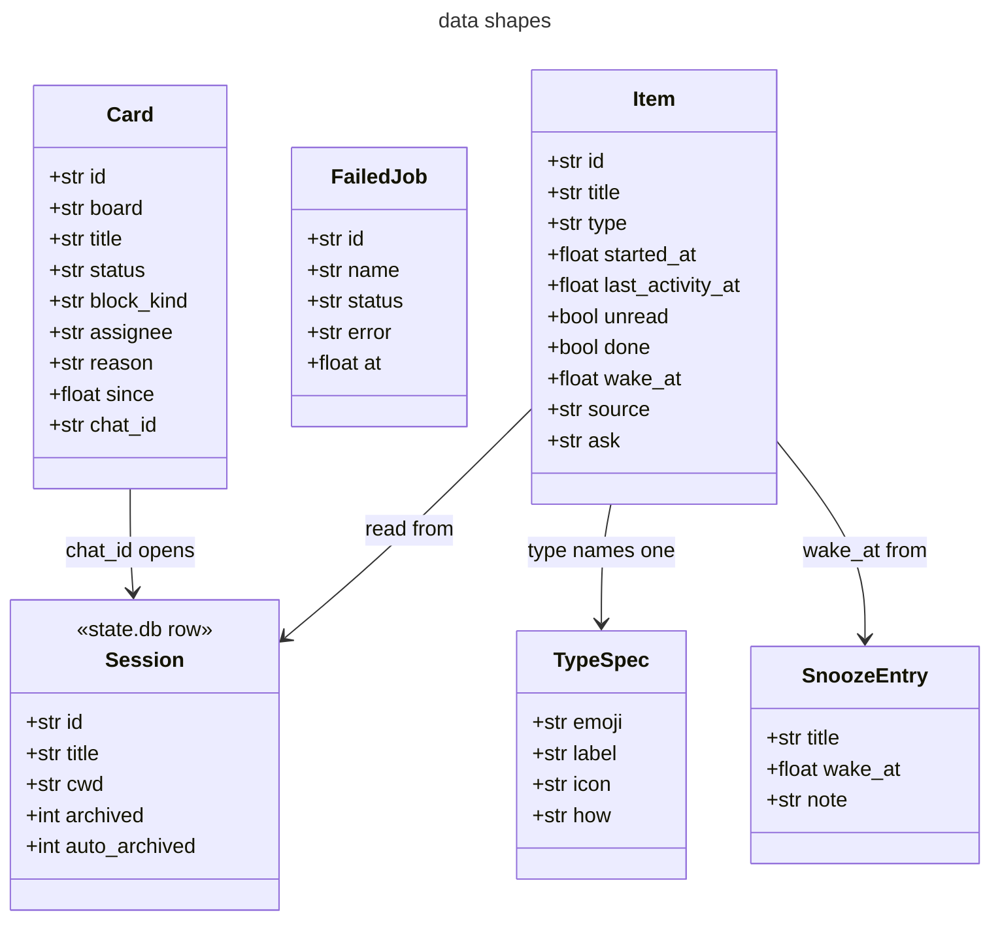

# Class diagram

The Python code has no classes for its data except the webhook `Handler`. Functions pass plain `dict` values. This page shows the shape of those dicts and which function makes each one. The field names come from the return statements in [`core.py`](../../../desktop_inbox/core.py) and [`settings.py`](../../../desktop_inbox/settings.py).

## Data shapes

## Shapes

| Shape | Made by | Notes |
|---|---|---|
| Item | `core.list_items` | `done` is true only when the session is archived on purpose and has no snooze. `wake_at` is `None` for an item that is not snoozed. |
| TypeSpec | `settings.types` | One value per type name. The pane receives only `label` and `icon`. |
| SnoozeEntry | `core.snooze` | Stored in `snooze.json`, keyed by session id. |
| FailedJob | `core.failed_jobs` | `status` is the cron `last_status`, or `inbox_failed`. `error` is at most 300 characters. |
| Card | `core.attention_cards` | `status` is `blocked` or `triage`. `chat_id` is `None` when no `local` chat subscribes to the card. |
| Session | Hermes `state.db` | Read with `mode=ro`. Changed only through `SessionDB`. |

## Webhook handler

`webhook.Handler` extends `http.server.BaseHTTPRequestHandler`. It defines `do_POST`, `do_GET`, `_send` and an empty `log_message`. `ThreadingHTTPServer` runs it with `daemon_threads = True`.
