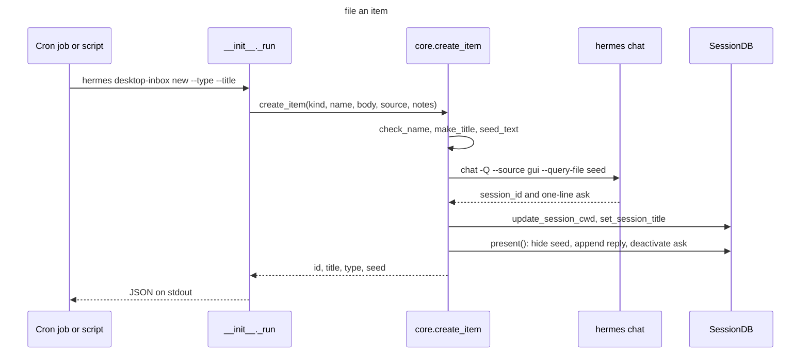
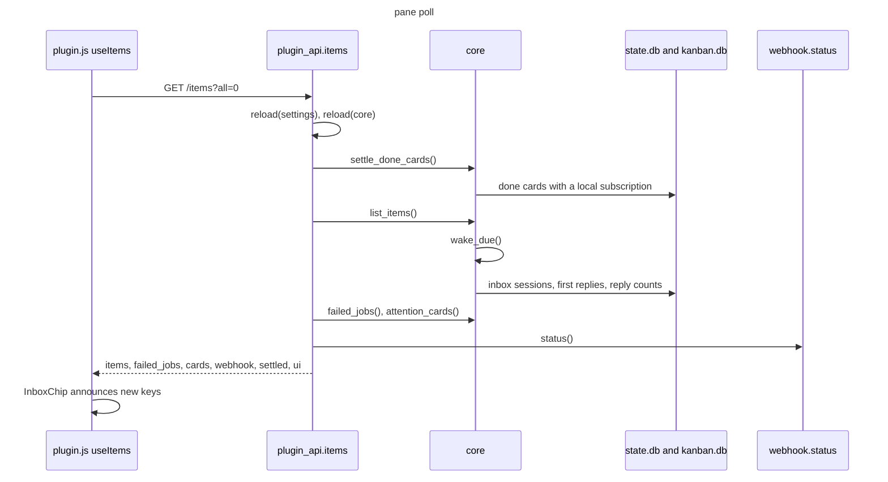
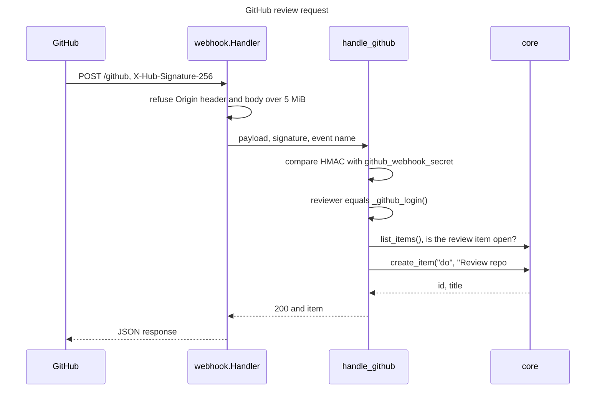
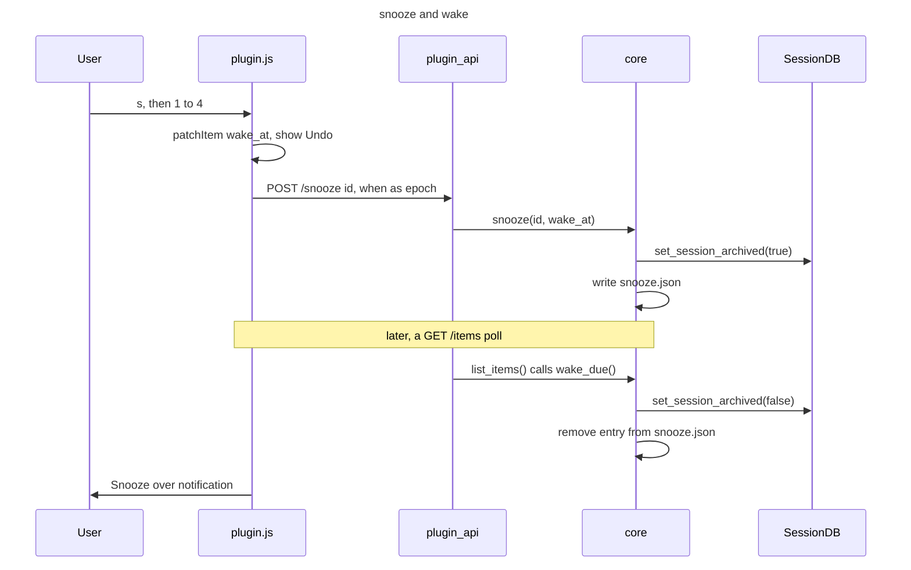

# Sequence diagrams

Four workflows, each traced to the functions that run them.

## Workflow: file an item from the CLI

A cron job or a script runs `hermes desktop-inbox new`. This takes one model turn, so it runs for 10 to 30 seconds.

### Walkthrough

1. **Parse**: `_run` in [`__init__.py`](../../../__init__.py) reads the body from `--body`, `--body-file` or stdin.
2. **Check**: `create_item` in [`core.py`](../../../desktop_inbox/core.py) checks the type and the name, and refuses an empty body.
3. **Seed**: `seed_text` writes `.seeds/<stamp>-<slug>.md` in the inbox folder.
4. **Turn**: `subprocess.run` starts `hermes chat` in the inbox folder with the environment from `_clean_env`.
5. **File**: `SessionDB` moves the session to the inbox folder and sets the title.
6. **Present**: `present` rewrites the first reply. A failure here leaves a plainer item.
7. **Verify**: `create_item` reads the row again and raises `SystemExit` when `cwd` or the title does not match.

## Workflow: pane poll

The pane asks for its data every 60 seconds. This poll also wakes snoozes and settles finished cards.

### Walkthrough

1. **Query**: `useItems` in [`plugin.js`](../../../desktop/plugin.js) calls `ctx.rest('/items?all=0')`.
2. **Reload**: `items` in [`plugin_api.py`](../../../dashboard/plugin_api.py) reloads `settings` and `core`.
3. **Settle**: `settle_done_cards` archives inbox items whose card is done.
4. **List**: `list_items` wakes due snoozes, then reads sessions and briefs.
5. **Attention**: `failed_jobs` reads `cron/jobs.json`. `attention_cards` reads every `kanban.db`.
6. **Notify**: `InboxChip` compares keys with `ctx.storage` through `diffSeen` and calls `announce`.

## Workflow: GitHub review request

GitHub posts a `pull_request` event with action `review_requested` to the listener, through a tunnel.

### Walkthrough

1. **Guard**: `Handler.do_POST` in [`webhook.py`](../../../desktop_inbox/webhook.py) refuses browser requests and large bodies.
2. **Verify**: `handle_github` returns `403` when the secret is not set or the HMAC does not match.
3. **Filter**: the handler ignores `ping`, events without a `pull_request`, and reviews asked of another login.
4. **Fold**: `_already_open` returns the open item for the same PR, and no second item is filed.
5. **File**: `create_item` files a `do` item with `github_review_notes` or `DEFAULT_REVIEW_NOTES` as reply notes.

## Workflow: snooze and wake

The user presses `s` on a row and picks a time. Later, a poll wakes the item.

### Walkthrough

1. **Pick**: `SnoozeMenu` in [`plugin.js`](../../../desktop/plugin.js) gives four times from `snoozeOptions()`.
2. **Apply**: `makeActions().snooze` patches the cache, posts `/snooze` and registers an undo that posts `/wake`.
3. **Store**: `core.snooze` archives the session and adds the entry to `snooze.json`.
4. **Wake**: `wake_due` runs at the start of every `list_items` call and un-archives due items.
5. **Announce**: `InboxChip` compares the `snoozedAt` map in `ctx.storage` with the open items and announces items whose wake time has passed.
